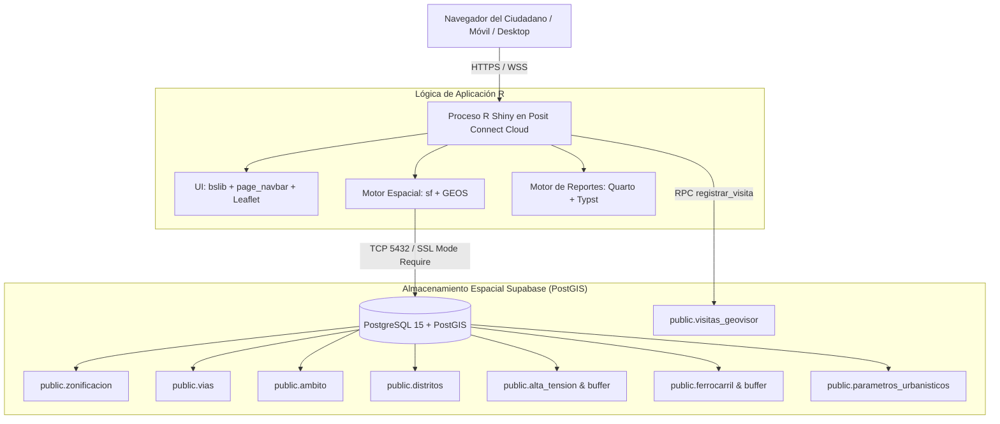
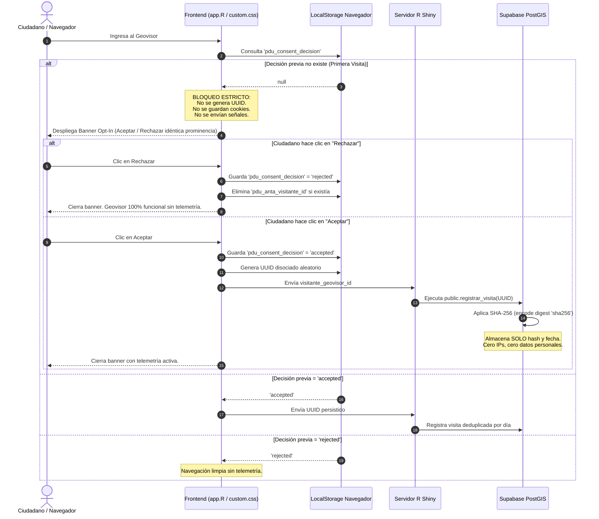

# Documentación Técnica y Sustento de Implementación: GeoVisor PDU Anta (2024 - 2034)

**Entidad Titular:** Municipalidad Provincial de Anta (Cusco, Perú)  
**Órgano Responsable:** Gerencia de Desarrollo Urbano y Rural (GDUR)  
**Proyecto:** *«Mejoramiento de los Servicios de Gestión Territorial y Desarrollo Urbano Sostenible, del distrito de Anta, provincia de Anta, departamento del Cusco»*  
**Instrumento de Planificación:** Plan de Desarrollo Urbano (PDU) de Anta 2024 - 2034  
**Fecha de Aprobación Oficial:** 11 de abril de 2025 (Ordenanza Municipal Nº 04-2025-A-MPA/C, publicada en El Peruano)  
**Actualización Normativa:** 04 de septiembre del 2026 (Ordenanza Municipal N° 008-2026-A-MPA-C)  
**Entorno de Despliegue:** Posit Connect Cloud / Shiny Server / Local Storage & Neon PostgreSQL  
**Última Actualización Técnica:** Octubre 2026  

---

## Índice General

1. [Marco Institucional y Objetivos del Proyecto](#1-marco-institucional-y-objetivos-del-proyecto)
2. [Arquitectura General del Sistema y Fuente de Datos Cloud](#2-arquitectura-general-del-sistema-y-fuente-de-datos-cloud)
3. [Seguridad, Tratamiento de Información y Consentimiento Opt-In (Ley N° 29733)](#3-seguridad-tratamiento-de-información-y-consentimiento-opt-in-ley-n-29733)
4. [Lanzamiento Cartográfico y Visualización Espacial](#4-lanzamiento-cartográfico-y-visualización-espacial)
5. [Integración y Lógica Espacial del Sistema Vial Propuesto](#5-integración-y-lógica-espacial-del-sistema-vial-propuesto)
6. [Identidad Visual Institucional y Paleta Oficial de Zonificación](#6-identidad-visual-institucional-y-paleta-oficial-de-zonificación)
7. [Diseño Frontend, Navegación Modular y Erradicación de Errores de Contraste](#7-diseño-frontend-navegación-modular-y-erradicación-de-errores-de-contraste)
8. [Generador de Reportes Informativos (Quarto + Typst)](#8-generador-de-reportes-informativos-quarto--typst)
9. [Adaptabilidad Móvil y Diseño Responsivo](#9-adaptabilidad-móvil-y-diseño-responsivo)
10. [Trazabilidad, Validación Automatizada y Mantenimiento](#10-trazabilidad-validación-automatizada-y-mantenimiento)

---

## 1. Marco Institucional y Objetivos del Proyecto

El **GeoVisor PDU Anta (2024 - 2034)** es una plataforma web de información geográfica y gestión territorial desarrollada para democratizar el acceso a la normativa urbanística aprobada para el ámbito de intervención de la provincia de Anta (abarcando sectores de los distritos de Anta, Pucyura, Cachimayo, Huarocondo y Zurite con una superficie reglamentada de aproximadamente 9,469.35 hectáreas).

### Objetivos Específicos:
1. **Acceso Ciudadano Transparente:** Permitir la consulta interactiva de zonificación, parámetros urbanísticos y afectaciones viales mediante coordenadas UTM/geográficas o dibujo/carga de polígonos prediales.
2. **Seguridad Jurídica y Técnica:** Proveer fichas técnicas referenciales que reflejen con precisión matemática las determinaciones del PDU aprobado el 11 de abril de 2025 mediante O.M. Nº 04-2025-A-MPA/C y actualizado el 04 de septiembre del 2026 mediante O.M. N° 008-2026-A-MPA-C, resguardando el carácter informativo que no sustituye el trámite municipal.
3. **Privacidad y Cumplimiento Legal:** Respetar los estándares de la Ley N° 29733 (Ley de Protección de Datos Personales del Perú) y directivas internacionales contra *dark patterns*, implementando consentimiento *Opt-In* previo.
4. **Alta Disponibilidad y Rendimiento Cloud:** Operar mediante una infraestructura moderna en la nube con Posit Connect y Supabase PostgreSQL/PostGIS.

---

## 2. Arquitectura General del Sistema y Fuente de Datos Cloud

La plataforma implementa una arquitectura desacoplada y orientada a servicios para asegurar máxima escalabilidad y aislamiento de responsabilidades:



### 2.1 Tablas Oficiales en PostGIS
Todas las capas espaciales oficiales residen en el esquema `public` de PostgreSQL con índices espaciales GiST (`idx_*_geom`) y sistema de referencia de coordenadas normalizado en WGS84 (`EPSG:4326`) para visualización y UTM Zona 18S (`EPSG:32718`) para cálculos métricos:

| Tabla PostGIS | Entidades | Geometría | Descripción |
| :--- | :---: | :---: | :--- |
| `public.zonificacion` | 2,741 | Polígonos | Subzonas normadas, usos y codificación oficial |
| `public.vias` | 1,729 | Líneas | Ejes del Sistema Vial Propuesto y secciones normativas |
| `public.ambito` | 1 | Polígono | Límite del Ámbito de Intervención del PDU Anta |
| `public.distritos` | 9 | Polígonos | Delimitaciones distritales del entorno provincial |
| `public.alta_tension` | 7 | Líneas | Trazado de líneas eléctricas L-1002 (220 kV) y L-1007 (138 kV) |
| `public.alta_tension_buffer` | 4 | Polígonos | Fajas de servidumbre eléctrica oficial (20 m y 25 m) |
| `public.ferrocarril` | 5 | Líneas | Eje del Ferrocarril Trasandino (D.S. 032-2005-MTC) |
| `public.ferrocarril_buffer` | 5 | Polígonos | Área referencial de influencia y derecho de vía férreo |
| `public.parametros_urbanisticos` | 40 | Tabular | Matriz reglamentaria de densidad, lote, frente, altura y área libre |

### 2.2 Seguridad y Row Level Security (RLS)
- **Restricción de Descarga Directa:** El esquema `public` tiene RLS activado. Se revocó el privilegio `SELECT` directo a los roles `anon` y `authenticated` para evitar la descarga o raspado (*scraping*) masivo no autorizado de las capas geográficas propietarias de la Municipalidad.
- **Canal de Conexión Seguro:** El proceso Shiny se conecta mediante credenciales institucionales administradas como variables de entorno cifradas en Posit Connect (`SUPABASE_HOST`, `SUPABASE_DB`, `SUPABASE_USER`, `SUPABASE_PASSWORD`, `SUPABASE_PORT`) forzando `sslmode = "require"`.
- **Archivo de Conexión:** [`R/supabase_utils.R`](file:///d:/2026_GDUR/pdu_anta_2024_2034/R/supabase_utils.R).

---

## 3. Seguridad, Tratamiento de Información y Consentimiento Opt-In (Ley N° 29733)

Para garantizar el cumplimiento de la **Ley N° 29733 (Ley de Protección de Datos Personales del Perú)**, su reglamento (**D.S. N° 003-2013-JUS**) y normativas internacionales (RGPD / Directiva ePrivacy), la plataforma fue dotada de una política de **minimización radical de datos y consentimiento *Opt-In* previo estricto**.



### 3.1 Principios del Tratamiento de Información

1. **Consentimiento Previo Libre y Expreso (Opt-In):** Ninguna función de telemetría se activa antes de que el usuario pulse voluntariamente el botón *"Aceptar"*.
2. **Simetría y Paridad Visual (Anti *Dark Patterns*):**
   - Los botones *"Aceptar"* y *"Rechazar"* poseen **el mismo nivel de prominencia visual**.
   - Cuentan con idénticas dimensiones mínimas (`min-width: 125px`), mismo relleno (`padding: 0.55rem 1.25rem`), idéntico grosor de borde (`1.5px solid`) y tipografía con igual peso visual (`font-weight: 600`), erradicando botones engañosos ("fantasmas" o desproporcionados).
3. **Minimización y Anonimización (Sin Dirección IP):**
   - **No se almacena la dirección IP** del visitante ni cabeceras *User-Agent*.
   - La base de datos recibe el identificador volátil y lo transforma inmediatamente mediante función criptográfica unidireccional **SHA-256**:
     ```sql
     INSERT INTO public.visitas_geovisor (visitante_hash)
     VALUES (encode(extensions.digest(trim(p_visitante), 'sha256'), 'hex'))
     ON CONFLICT (visitante_hash, fecha_visita) DO NOTHING;
     ```
   - El hash es irreversible y solo se utiliza para deduplicar visitas diarias para la estadística municipal.
4. **Geolocalización GPS No Automática:**
   - La ubicación por GPS jamás se invoca en segundo plano. Requiere que el usuario pulse activamente el botón `btn_gps_movil` y autorice el diálogo nativo del navegador.
   - Las coordenadas obtenidas residen únicamente en la memoria volátil de la sesión activa de R para centrar el mapa y no se almacenan en base de datos.
5. **Consultas de Predios Protegidas:**
   - Los polígonos o coordenadas que los ciudadanos suben o consultan no son registrados ni vinculados a ninguna identidad.
6. **Modal de Política de Privacidad y Derechos ARCO:**
   - Accesible permanentemente desde el banner inferior y desde el menú superior (*"Normativa e Información" → "Política de Privacidad y Datos"*).
   - Canal oficial de contacto: Mesa de Partes de la Municipalidad Provincial de Anta (`mesadepartes@munianta.gob.pe`).
   - Permite al usuario revocar o cambiar su decisión de consentimiento en cualquier momento.

---

## 4. Lanzamiento Cartográfico y Visualización Espacial

### 4.1 Enfoque Automático a la Capa de Zonificación Urbana
Conforme a los requerimientos de usabilidad técnica, se optimizó el lanzamiento cartográfico del mapa Leaflet:
- **Problema previo:** El visor iniciaba encuadrando el ámbito provincial total (`capas$ambito`), que al comprender más de 9,400 hectáreas de valles y cordilleras rurales, dejaba la zona urbana en una escala muy lejana e ilegible.
- **Solución implementada:** Al renderizar `output$mapa_pdu`, se calcula dinámicamente el *Bounding Box* de la capa `capas$zonificacion`:
  ```r
  zonif_bbox <- st_bbox(st_transform(capas$zonificacion, CRS_GEOGRAFICO))
  fitBounds(
    lng1 = unname(zonif_bbox["xmin"]),
    lat1 = unname(zonif_bbox["ymin"]),
    lng2 = unname(zonif_bbox["xmax"]),
    lat2 = unname(zonif_bbox["ymax"])
  )
  ```
- **Resultado:** El ciudadano aterriza visualmente directo en el tejido urbano reglamentado, visualizando de inmediato manzanas, códigos de subzona y colores oficiales.

### 4.2 Optimización de Enfoque en Dispositivos Móviles (Smartphones)
- **Problema en móviles:** En pantallas de smartphones, el cálculo del viewport (`100dvh` / barra de navegación dinámica) y el colapso del sidebar en CSS Grid provocan un desfase de milisegundos en Leaflet. Al inicializarse el mapa con dimensiones aún no consolidadas por el navegador móvil, `fitBounds` se ejecutaba contra un contenedor de tamaño cero o inestable, quedando el mapa en escala lejana o fuera de foco.
- **Solución implementada:**
  1. **`htmlwidgets::onRender` Progresivo:** Invocación escalonada (a 150ms, 600ms y 1400ms) de `map.invalidateSize()` y `map.fitBounds(zonifBounds)` en el cliente una vez estabilizado el layout móvil.
  2. **Eventos Reactivos de Pantalla:** Enlace a `resize`, `orientationchange` y `shown.bs.tab` para recentrar automáticamente si el usuario rota el teléfono o cambia de pestaña.
  3. **Refuerzo en Servidor:** Observer `session$onFlushed` con `leafletProxy("mapa_pdu")` para forzar el encuadre una vez conectado el WebSocket del cliente.
  4. **CSS Contenedor Móvil:** Asignación explícita de `min-height: 480px` y `height: calc(100dvh - 66px)` en `#mapa_pdu` para garantizar dimensiones inmediatas.

### 4.3 Botón de Restablecimiento Rápido de Encuadre
Se incorporó un control `EasyButton` en el cuadrante superior izquierdo con el ícono `fa-expand` (*"Ajustar vista a Zonificación PDU"*), permitiendo al usuario volver instantáneamente al encuadre urbano principal tras realizar navegaciones profundas o búsquedas remotas (incluyendo `map.invalidateSize()` previo).

---

## 5. Integración y Lógica Espacial del Sistema Vial Propuesto

### 5.1 Fuente de Datos y Estandarización
- **Capa Base:** `public.vias` (1,729 entidades lineales con topología validada y CRS métrico EPSG:32718).
- **Jerarquía Oficial (`SIS_VIAL`):**
  1. *Sistema Vial Provincial-Metropolitano* (Grosor: `2.2`, trazo: línea discontinua larga `#9A6B1F`).
  2. *Sistema Vial Primario* (Grosor: `2.0`, trazo: discontinuo medio `#A23E3A`).
  3. *Sistema Vial Secundario* (Grosor: `1.6`, trazo: discontinuo corto `#2E6B57`).
  4. *Sistema Vial Especial* (Grosor: `1.7`, trazo: punteado `#6B5A88`).

### 5.2 Buffer Metodológico Estricto de 25 Metros
- **Lógica de Cruce Espacial:** Tanto en consultas puntuales como en polígonos prediales, se evalúa una zona de influencia máxima de **25 metros lineales** (`distancia <= 25 m`) respecto al eje normativo.
- **Exclusión de Longitudes Irrelevantes:** Se eliminó deliberadamente la longitud longitudinal de vía individual para evitar confusiones catastrales en el lote.
- **Nota Metodológica Obligatoria:**
  > *«Las vías del Sistema Vial Propuesto mostradas corresponden a los ejes normativos identificados dentro de un área de influencia directa (buffer de 25 metros) respecto al perímetro del predio o punto consultado.»*

---

## 6. Identidad Visual Institucional y Paleta Oficial de Zonificación

El Geovisor adopta estrictamente la paleta cromática aprobada por la Gerencia de Desarrollo Urbano y Rural para el PDU Anta 2024 - 2034:

### A. Zonificación Residencial y Densidades
| Código Subzona | Denominación Oficial | Color Hex | Tono Visual |
| :--- | :--- | :---: | :--- |
| `ZDA - C` | Zona de Densidad Alta - Consolidada | `#C86868` | Rojo ladrillo medio |
| `ZDA - S` | Zona de Densidad Alta - Semiconsolidada | `#F49494` | Rosa rojizo |
| `ZDM - C - I` | Zona de Densidad Media - Consolidada I | `#F67777` | Rojo salmón vivo |
| `ZDM - C - II` | Zona de Densidad Media - Consolidada II | `#F5AA7A` | Salmón anaranjado |
| `ZDM - S - I` | Zona de Densidad Media - Semiconsolidada I | `#FCA8A8` | Rosa pastel claro |
| `ZDM - S - II` | Zona de Densidad Media - Semiconsolidada II | `#FDE0DC` | Rosa pálido |
| `ZDM - CR - I` | Zona de Densidad Media - Con Reglamentación I | `#ECA080` | Salmón trama |
| `ZDB - C - I` | Zona de Densidad Baja - Consolidada I | `#F2964C` | Naranja cálido |
| `ZDB - C - II` | Zona de Densidad Baja - Consolidada II | `#F7B865` | Naranja amarillento |
| `ZDB - S - I` | Zona de Densidad Baja - Semiconsolidada I | `#FDE4B0` | Crema anaranjado |
| `ZDMB - S - I` | Zona de Densidad Muy Baja - Semiconsolidada I | `#E5E64B` | Amarillo lima |
| `ZDMB - S - II` | Zona de Densidad Muy Baja - Semiconsolidada II | `#F6F255` | Amarillo brillante |

### B. Equipamientos, Servicios e Industria
| Código Subzona | Denominación Oficial | Color Hex | Tono Visual |
| :--- | :--- | :---: | :--- |
| `E1` | Educación Básica | `#D4E7F5` | Celeste claro |
| `E2` | Educación Superior Tecnológica | `#A9CEEC` | Celeste medio |
| `H1` | Posta Médica | `#C6E2E1` | Turquesa pastel |
| `H2` | Centro de Salud | `#99D5D2` | Turquesa medio |
| `H3` | Hospital General | `#80BDBB` | Turquesa oscuro |
| `ZRP` | Zona de Recreación Pública | `#BEDB92` | Verde manzana |
| `ZOU` | Zona de Otros Usos | `#BCBDBE` | Gris medio |
| `I1` | Industria Elemental | `#E2D4E4` | Lila pastel |
| `I2` | Industria Liviana | `#B2AECB` | Lavanda medio |
| `ZA` | Zona Agraria | `#EFF6D3` | Amarillo marfil |

### C. Zonas de Protección y Reglamentación Especial
| Código Subzona | Denominación Oficial | Color Hex | Tono Visual |
| :--- | :--- | :---: | :--- |
| `ZM` | Zona Monumental | `#DDD4CE` | Beige arena |
| `ZPA - CE` | Conservación Ecológica | `#80C880` | Verde esmeralda |
| `ZPA - RH` | Recursos Hídricos / Fajas Marginales | `#80C8F6` | Azul hídrico |
| `ZPA - IERE` | Recuperación de Ecosistemas | `#E5F69A` | Verde lima claro |
| `ZRE - NU - P` | No Urbanizable por Peligro Alto | `#7F8285` | Gris plomo |
| `ZRE - NU - RE` | No Urbanizable por Riesgo Eléctrico | `#686B6E` | Gris oscuro |
| `ZRE - PMA - S` | Peligro Muy Alto por Sismicidad | `#CB7B9E` | Rosa magenta |
| `ZRE - PA - C` | Protección Calpitocasa | `#AFA39A` | Marrón grisáceo |
| `ZRE - VHC - CH` | Centro Histórico | `#5D5E60` | Carbón oscuro |
| `ZRE - CBIP` | Bien Inmueble Prehispánico | `#CBA362` | Ocre dorado |

---

## 7. Diseño Frontend, Navegación Modular y Erradicación de Errores de Contraste

### 7.1 Corrección del Error de Texto Blanco sobre Blanco
- **Diagnóstico del Fallo:** El tema Bootswatch *Flatly* forzaba por defecto variables `--bs-navbar-color: #ffffff` y `--bs-navbar-brand-color: #ffffff`. Dado que `page_navbar` de Shiny renderiza elementos `ul.navbar-nav > li > a` sin la clase `.nav-link`, los enlaces inactivos y microcontadores quedaban en color blanco sobre el fondo blanco del navbar, haciéndose invisibles a menos que se seleccionaran con el cursor.
- **Solución Implementada en [`www/custom.css`](file:///d:/2026_GDUR/pdu_anta_2024_2034/www/custom.css):**
  - Sobreescritura forzada de variables CSS: `--bs-navbar-color: #174A3A !important`, `--bs-nav-link-color: #174A3A !important`.
  - Reglas universales para `.navbar .navbar-nav > li > a`, `.nav-link`, `.dropdown-toggle` y `:where(ul.nav.navbar-nav > li) > a`.
  - **Pestañas Inactivas:** Fondo píldora suave institucional `#F1F6F3`, borde `#CFE0D7`, texto e íconos en Verde Bosque Andino (`#174A3A`).
  - **Hover:** Transición a `#E2ECE6`, borde `#B2CDC0`, texto verde oscuro (`#0E3529`) con micro-elevación de 1 px.
  - **Pestaña Activa:** Gradiente institucional `#174A3A` a `#0E3529`, borde `#0B2B22`, texto e íconos en blanco nítido (`#FFFFFF`) y sombra tridimensional.
  - **Microcontadores:** Pastillas `#EDF4F0` con texto `#1E382B !important` y valor en `#174A3A !important`.

### 7.2 Redistribución Equilibrada del Encabezado
Para evitar que las pestañas sufrieran saltos de línea forzados (*wrapping*) en computadoras portátiles (1366 × 768 px o con escalado de 125 %/150 %):
1. **Extremo Izquierdo (Identidad Institucional en 2 Niveles):**
   - *Fila 1:* Escudo Provincial + `GEOVISOR PDU ANTA` (bold `#174A3A`) + Insignia `2024 - 2034` + Insignia `Aprobado: 04 de abril del 2025` (fondo crema cálido).
   - *Fila 2:* Subtítulo `Municipalidad Provincial de Anta • Sistema de Información Territorial y Gestión Urbana` en gris institucional `#3F564C`.
2. **Centro (Navegación Unificada):**
   - *Visor Territorial y Consultas*, *Reporte Informativo* y el desplegable *Normativa e Información* alineados con `flex-wrap: nowrap !important` en pantallas `>= 992px`.
3. **Extremo Derecho (Telemetría y Validación):**
   - Microcontadores de visitas y constancias ubicados tras el espaciador elástico `nav_spacer()`, junto al emblema oficial PDU (`pdu_actualizado_sf.png`).

---

## 8. Generador de Reportes Informativos (Quarto + Typst)

### 8.1 Motor de Compilación
- **Tecnología:** Quarto CLI con backend de renderizado **Typst**.
- **Ventajas:** Generación de PDF en menos de 1.2 segundos, cero dependencias pesadas de LaTeX, independencia de navegadores headless (Chrome/Chromium) y estabilidad en entornos Linux/Posit Connect.
- **Plantilla:** [`constancia_pdu_template.qmd`](file:///d:/2026_GDUR/pdu_anta_2024_2034/constancia_pdu_template.qmd).

### 8.2 Estructura Exacta de 2 Páginas (A4)
1. **Página 1 (Plano Cartográfico a Página Completa):**
   - Membrete institucional oficial y código único de consulta.
   - Resumen de identificación predial (coordenadas UTM Este/Norte, distrito, ámbito).
   - **Plano Catastral de Alta Resolución sin Letterboxing:** Relación de aspecto calculada en 1.464 (`8.2 x 5.6 pulgadas`), Rosa de los Vientos y Escala Gráfica sobre tarjetas antisolapamiento con fondo translúcido (`alpha = 0.90`).
2. **Página 2 (Ficha Técnica y Dictamen Normativo):**
   - Métricas detalladas (área, perímetro, centroide en UTM Zona 18S redondeados a máximo 3 decimales).
   - Tabla del Sistema Vial Propuesto (Buffer de 25 m con Nota Metodológica).
   - Desglose de zonificación y afectaciones (Alta Tensión / Ferrocarril).
   - Matriz de Parámetros Urbanísticos Reglamentarios aplicables por zona.
   - Descargo legal sobre el carácter exclusivamente informativo del reporte.

---

## 9. Adaptabilidad Móvil y Diseño Responsivo

El Geovisor incorpora controles específicos para teléfonos inteligentes y tabletas:
- **Meta Viewport:** `<meta name="viewport" content="width=device-width, initial-scale=1, shrink-to-fit=no">`.
- **Prevención de Desbordamiento:**
  ```css
  html, body {
    width: 100% !important;
    max-width: 100vw !important;
    overflow-x: hidden !important;
  }
  ```
- **Menú Colapsable Tipo Drawer:** En resoluciones `< 992px`, el menú se repliega tras el botón hamburguesa (`navbar-toggle`), desplegando opciones táctiles de ancho completo con padding optimizado.
- **Altura Dinámica de Mapa:** Ajuste con unidades de viewport modernas `calc(100dvh - 66px)` en Leaflet, eliminando barras de desplazamiento vertical duplicadas y espacios en blanco laterales.

---

## 10. Trazabilidad, Validación Automatizada y Mantenimiento

### 10.1 Suite de Pruebas Unitarias e Integración (`testthat`)
El repositorio cuenta con pruebas automatizadas continuas ubicadas en `tests/testthat/`:
- [`tests/testthat/test-spatial-utils.R`](file:///d:/2026_GDUR/pdu_anta_2024_2034/tests/testthat/test-spatial-utils.R): 11 pruebas de validación de coordenadas, polígonos, intersecciones y recortes cartográficos.
- [`tests/testthat/test-supabase-spatial.R`](file:///d:/2026_GDUR/pdu_anta_2024_2034/tests/testthat/test-supabase-spatial.R): 4 pruebas de integridad de tablas PostGIS, esquemas y paleta cromática.
- **Estado de Pruebas:** **15 aprobadas, 0 fallidas, 0 advertencias (100% PASS)**.

### 10.2 Matriz de Trazabilidad de Archivos Fuente

| Archivo / Componente | Función Técnica | Estado |
| :--- | :--- | :---: |
| [`app.R`](file:///d:/2026_GDUR/pdu_anta_2024_2034/app.R) | Interfaz Shiny, server reactivo, control de privacidad Opt-In y mapas | Operativo |
| [`www/custom.css`](file:///d:/2026_GDUR/pdu_anta_2024_2034/www/custom.css) | Sistema de diseño institucional, contraste de navbar, banner y móvil | Operativo |
| [`R/supabase_utils.R`](file:///d:/2026_GDUR/pdu_anta_2024_2034/R/supabase_utils.R) | Conexión DBI PostGIS, lectura de capas, RPC de telemetría y paletas | Operativo |
| [`R/spatial_utils.R`](file:///d:/2026_GDUR/pdu_anta_2024_2034/R/spatial_utils.R) | Validación de coordenadas, normalización predial y cálculos métricos | Operativo |
| [`constancia_pdu_template.qmd`](file:///d:/2026_GDUR/pdu_anta_2024_2034/constancia_pdu_template.qmd) | Plantilla Quarto/Typst para emisión de reporte en 2 páginas A4 | Operativo |
| [`supabase/migrations/002_metricas_geovisor.sql`](file:///d:/2026_GDUR/pdu_anta_2024_2034/supabase/migrations/002_metricas_geovisor.sql) | Esquema SQL de telemetría, seguridad RLS y funciones RPC | Aplicado |
| [`supabase/migrations/003_corregir_contadores_geovisor.sql`](file:///d:/2026_GDUR/pdu_anta_2024_2034/supabase/migrations/003_corregir_contadores_geovisor.sql) | Hash criptográfico SHA-256 para anonimización de visitas sin IP | Aplicado |
